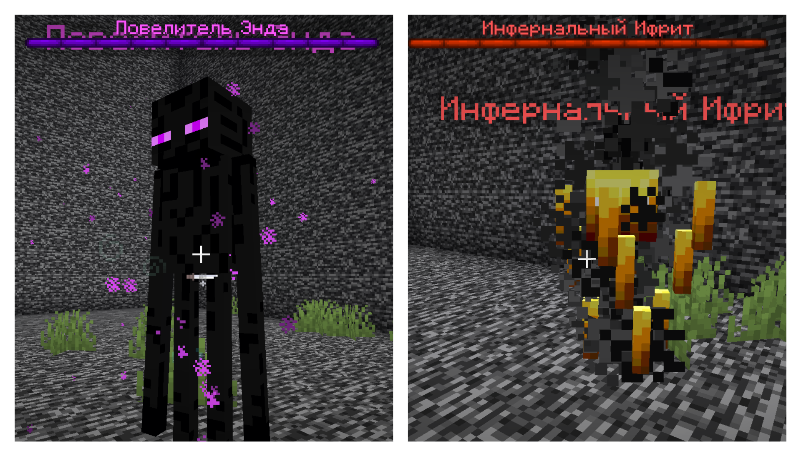
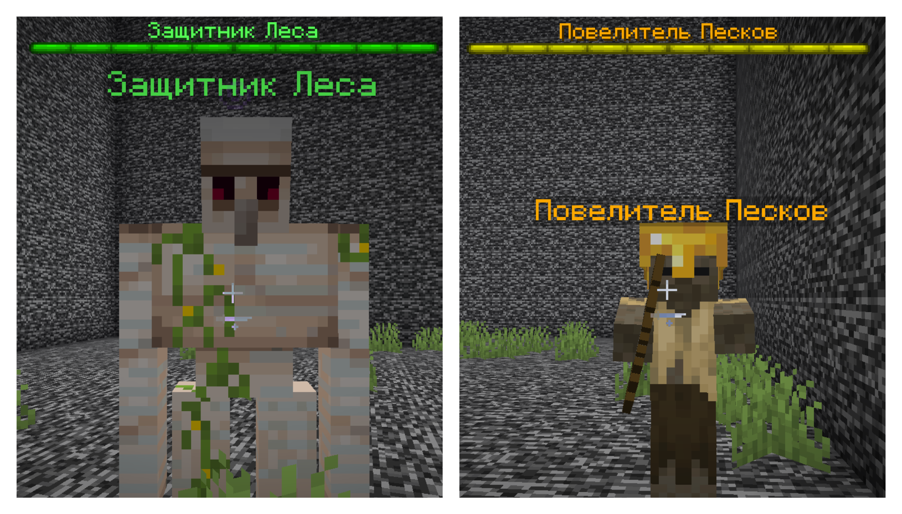

# MiniBosses

MiniBosses — плагин для Minecraft 1.21.10 (Paper), который добавляет уникальных мини-боссов в разные измерения и биомы мира. Каждый босс обладает особыми способностями, призывает помощников при низком здоровье и оставляет ценные награды.  
Теперь для игроков доступна **покупка боссов за игровую валюту** (через CoinsEngine).

---

## 🎯 Возможности

- **4 уникальных мини-босса** для разных биомов и измерений
- **Автоматический спавн** с настраиваемыми шансами и кулдаунами
- **Покупка боссов за валюту** (через CoinsEngine, опционально)
- **Просмотр статистики** — количество активных и заспавненных боссов
- **Удаление всех активных боссов** одной командой
- **Боссбары** с отображением здоровья в реальном времени
- **Специальные способности** для каждого босса
- **Система помощников** — при 60%, 40% и 20% HP боссы призывают союзников
- **Интеграция с WorldGuard** — не спавнит босов на территориях с приватом
- **Настраиваемые награды** и команды при смерти
- **Устойчивость к перезагрузкам** — боссы сохраняются через Persistent Data
- **Гибкая система прав** с раздельными пермишенами
- **Проверка AFK** через Essentials
- **Игнорирование спавна** для игроков с пермишеном

---

## 👹 Боссы

### 🏹 Повелитель Энда
- **Спавн**: Энд
- **Сущность**: Эндермен
- **Способности**: Телепортация, ослепление игроков, телепортация игроков к себе
- **Помощники**: Эндермиты
- **Награды**: Жемчуг Края, Глаза Эндера, Хорус-фрукты, Раковины шалкеров

### 🔥 Инфернальный Ифрит
- **Спавн**: Адские крепости (Незер)
- **Сущность**: Ифрит
- **Способности**: Огненный шторм, файерболы, телепортация к игрокам
- **Помощники**: Магма-кубы
- **Награды**: Стержни ифрита, незерские кирпичи, золотые самородки



### 🌳 Защитник Леса
- **Спавн**: Лесные биомы
- **Сущность**: Железный голем
- **Способности**: Землетрясение, замедление, отбрасывание, притягивание игроков
- **Помощники**: Агрессивные волки
- **Награды**: Железо, яблоки, бревна

### 🏜️ Повелитель Песков
- **Спавн**: Пустынные биомы
- **Сущность**: Пустынный зомби (Хаск)
- **Способности**: Песчаная буря, голод, стрелы с замедлением
- **Помощники**: Пустынные зомби с лопатами
- **Награды**: Золото, кактусы, песчаник, шкуры кроликов



---

## ⚙️ Конфигурация

```yml
# Автоматический спавн
auto-spawn:
  enabled: true
  check-interval: 300        # Интервал проверки в секундах
  no-boss-spawn-radius: 100  # Радиус без других боссов

# Настройки покупки боссов
buy-cooldown: 86400000  # 24 часа в миллисекундах
buy-currency: money     # Валюта из CoinsEngine для покупки боссов

arrow-reflection-chance: 0.5 # Шанс отражения стрелы в игрока (0.0-1.0)
show-ability-message: false  # Показывать ли сообщения об использованных способностях

# Босс Энда
ender-boss:
  enabled: true
  spawn-chance: 1.0      # Шанс спавна в процентах
  cooldown: 3600         # Кулдаун в секундах
  health: 300.0          # Здоровье
  attack-multiplier: 3.0 # Множитель урона
  speed-multiplier: 1.2  # Множитель скорости
  ability-chance: 0.6    # Шанс использования способности (0.0-1.0)

  # Покупка
  buy-enabled: true
  buy-price: 25000
# ... и многие другие настройки

# Аналогичные настройки для nether-boss, forest-boss, desert-boss
```

**Полный конфиг:** [config.yml](src/main/resources/config.yml)

---

## 🎮 Команды и права

### Основные команды:
- `/minibosses reload` — перезагрузить конфигурацию
- `/minibosses spawn <тип>` — призвать босса (ender/nether/forest/desert)
- `/minibosses cleanup` — удалить всех активных боссов
- `/minibosses stats` — показать статистику плагина
- `/minibosses buy <тип>` — купить и призвать босса за игровую валюту
- `/minibosses help` — показать справку

### Система прав:
- `minibosses.admin` — полный доступ ко всем командам
- `minibosses.spawn` — право призывать боссов
- `minibosses.buy` — право покупать боссов за валюту
- `minibosses.reload` — право перезагружать конфиг
- `minibosses.cleanup` — право удалять активных боссов
- `minibosses.stats` — право просматривать статистику
- `minibosses.ignore` — игнорировать авто-спавн боссов рядом с игроком
- `minibosses.use` — базовый доступ к команде `/minibosses`
- `minibosses.*` — все права плагина

## 💰 Интеграция с CoinsEngine

Если установлен плагин **[CoinsEngine](https://github.com/nulli0n/CoinsEngine-spigot)**, MiniBosses может использовать игровую валюту для покупки боссов:

- Настройте цены для каждого босса `buy-enabled: true` и `buy-price: 25000` в `config.yml`
- Игроки с правом `minibosses.buy` могут использовать команду:
```/minibosses buy <тип>```
- При успешной покупке босс сразу призывается рядом с игроком
- Если у игрока недостаточно средств, выводится соответствующее сообщение

*(Интеграция опциональна — если CoinsEngine не установлен, система автоматически отключается)*

---

## 🚀 Установка

1. **Скачайте последний релиз** из раздела [Releases](../../releases)
2. **Поместите файл** `.jar` в папку `/plugins/`
3. **Перезапустите сервер**
4. **Настройте конфигурацию** в `/plugins/MiniBosses/config.yml`
5. **Используйте** `/minibosses reload` для применения изменений

---

## 🏗️ Архитектура

Плагин использует современную объектно-ориентированную архитектуру:

```
MiniBosses/
├── boss/                    # Система боссов
│   ├── MiniBoss.java       # Интерфейс босса
│   ├── AbstractMiniBoss.java # Базовый класс
│   └── *Boss.java          # Конкретные реализации
├── ConfigManager.java       # Управление конфигурацией
├── EconomyManager.java      # Управление экономикой
├── PlayerDataManager.java   # Управление данными игрока
├── BossManager.java         # Управление спавном и задачами
├── BossListener.java        # Обработчик событий
└── CommandHandler.java      # Система команд
```

**Особенности архитектуры:**
- ✅ **Persistent Data Container** - боссы сохраняются после перезагрузки
- ✅ **Интерфейсный подход** - легко добавлять новых боссов
- ✅ **Разделение ответственности** - каждый класс отвечает за свою зону
- ✅ **Типизированная конфигурация** - безопасный доступ к настройкам

---

## 🔧 Для разработчиков

### Добавление нового босса:
1. Создайте класс, реализующий `MiniBoss` интерфейс
2. Наследуйтесь от `AbstractMiniBoss` для базовой функциональности
3. Реализуйте методы способностей и помощников
4. Добавьте настройки в `ConfigManager`
5. Зарегистрируйте в `BossListener` и `BossManager`

---

## 📋 Требования

- **Minecraft**: 1.21.10 (Paper рекомендуется)
- **Java**: 21+
- **Опционально**:
    - WorldGuard - для интеграции с регионами
    - EssentialsX - для проверки AFK статуса
    - CoinsEngine — покупка боссов за валюту

---

## 📄 Лицензия

Плагин распространяется под лицензией MIT. Подробнее см. в файле [LICENSE](LICENSE).

---

## 🐛 Баги и предложения

Нашли баг или есть предложение по улучшению? Создайте [issue](../../issues) на GitHub!
